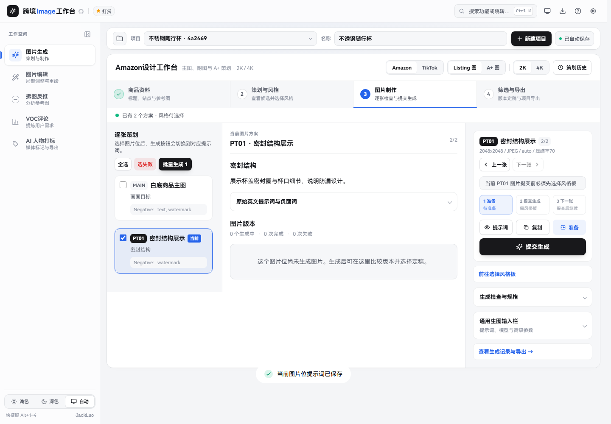

<!-- markdownlint-disable MD013 MD033 MD041 -->

<p align="center">
  
</p>

<h1 align="center">跨境Image工作台</h1>

<p align="center">
  面向 Amazon 与 TikTok Shop 的本地优先 AI 商品图片工作台
</p>

<p align="center">
  从商品资料、图片策划和风格板，到批量生成、编辑、选片与交付，统一在一条可恢复的工作流中完成。
</p>

<p align="center">
  <a href="https://china-luo.github.io/ImageStudioRemasteredVersion/">在线体验</a>
  ·
  <a href="https://github.com/china-luo/ImageStudioRemasteredVersion/releases/latest">下载 Windows 版</a>
  ·
  <a href="https://github.com/china-luo/ImageStudioRemasteredVersion/actions/workflows/deploy-pages.yml">部署记录</a>
  ·
  <a href="https://github.com/china-luo/ImageStudioRemasteredVersion/issues">提交 Issue</a>
</p>

<p align="center">
  <a href="https://github.com/china-luo/ImageStudioRemasteredVersion/actions/workflows/ci.yml"></a>
  <a href="https://github.com/china-luo/ImageStudioRemasteredVersion/releases/latest"></a>
  <a href="./LICENSE"></a>
  <a href="https://github.com/china-luo/ImageStudioRemasteredVersion/actions/workflows/deploy-pages.yml"></a>
  
  
</p>



## v2.0.3 更新

修复「习惯配置」里默认背景预览与工作台实际背景不一致的问题。默认预览会跟随主题变化，已有自定义图片仍可继续使用。

## v2.0.2 更新亮点

- **更清晰的制作流程**：按「商品资料 → 策划与风格 → 图片制作 → 筛选与导出」推进，桌面与移动端均可使用；支持浅色、深色和跟随系统主题。
- **快捷命令面板**：使用 `Ctrl+K`（macOS 为 `⌘K`）搜索功能；用 `Tab` 或方向键选择，按 `Enter` 执行。
- **更稳的项目与生成恢复**：缺少参考图时仍可切换和保存项目，导入同一 ID 的图片后恢复引用；已取得远端 ID 的任务只续查，不重新提交生成。

完整变化见 [更新日志](./CHANGELOG.md)。

## 这是什么

跨境Image工作台不是单纯的 Prompt 输入框，而是一套围绕电商图片生产设计的工作流工具：

- **先策划，再生产**：把标题、五点描述和参考图转成商品摘要、图片位方案、文案方向和英文生图提示词。
- **以项目为中心**：策划草稿、参考图、生成任务、图片版本和最终定稿按项目关联，切换页面、刷新或打开新标签页后仍可继续。
- **面向平台规范**：覆盖 Amazon Listing、Amazon A+ 和 TikTok Shop 图片流程，并按站点、模块和图片位组织输出。
- **模型配置不写死**：支持从 OpenAI-compatible 上游拉取 `/models` 列表，也可以手动添加或输入模型 ID。
- **本地优先**：任务、图片缓存、策划历史和工作区草稿保存在本地；Windows 桌面版使用系统加密凭据存储。

## 核心能力

| 模块 | 能力 |
| --- | --- |
| 图片制作 | 参考图上传与 `@图` 引用、尺寸/质量/格式参数、任务状态、重试、停止、批量生成 |
| Amazon Listing | US、JP、DE、FR、IT、ES 站点；`MAIN + PT01-PT06` 图片位；站点语言和可见文案约束 |
| Amazon A+ | 普通、标准、高级、移动端 A+ 模块；模块尺寸、文案方向、提示词和批量生成 |
| TikTok Shop | 美国站商品主图与移动端详情图工作流，支持平台内容约束和图片位策划 |
| AI 策划 | 商品信息摘要、逐图方案、动态风格候选、系列风格说明、策划历史和恢复 |
| 动态模型目录 | 从上游获取模型列表；单一可编辑模型输入框；下拉选择、手动添加和自定义模型并存 |
| 图片编辑 | 画布缩放、拖动、区域标注、撤销/重做、连续编辑；支持 OpenAI-compatible 与 Seedream Pro |
| 拆图反推 | 根据竞品图和商品资料生成中文拆解、迁移建议、image prompt 与 negative prompt |
| VOC 分析 | Shulex OpenAPI 按 ASIN 获取评论，或导入 CSV/XLSX，生成痛点、卖点和图片策略报告 |
| AI 人物打标 | 为已确认需要披露的图片或视频写入 Amazon XMP 标记，支持单文件和 ZIP；全程本地处理 |
| 历史与交付 | 搜索、收藏、筛选、批量下载、项目定稿、ZIP 导出和数据备份/恢复 |
| 工作区 | 自定义背景、响应式布局、持久化草稿、项目版本和跨标签页冲突保护 |

## 推荐工作流

```text
商品标题 / 五点描述 / 产品参考图
                ↓
      AI 策划商品信息与图片位方案
                ↓
         生成并选择动态风格板
                ↓
         校对图片位与生图提示词
                ↓
           批量提交图片生成
                ↓
       编辑、比较版本、确定项目定稿
                ↓
             ZIP / 图片交付
```

1. 创建或选择一个项目，填写商品标题、五点描述并上传产品参考图。
2. 选择 Amazon Listing、Amazon A+ 或 TikTok Shop 工作流，执行 AI 策划。
3. 查看商品摘要、图片位方案和动态风格候选，选择需要保留的风格方向。
4. 对单张图片位微调提示词，或批量选择图片位生成。
5. 在项目结果中比较生成版本，选择最终定稿并导出。

## 在线版与桌面版

### 在线体验

打开 [GitHub Pages 在线版](https://china-luo.github.io/ImageStudioRemasteredVersion/)。

在线版是静态 Web 应用，浏览器会直接请求你配置的上游 API。上游接口需要允许 CORS；如果出现 `Failed to fetch`、跨域或网关限制，建议使用 Windows 桌面版或本地开发代理。

### Windows 桌面版

从 [GitHub Releases](https://github.com/china-luo/ImageStudioRemasteredVersion/releases/latest) 下载最新 x64 安装包。桌面版通过 Electron 主进程使用受控网络通道，更适合日常生产、跨域受限接口和本地文件交付。

本次版本：[**v2.0.3**](https://github.com/china-luo/ImageStudioRemasteredVersion/releases/tag/v2.0.3)

### 静态部署

推送到 `main` 后，[GitHub Pages 工作流](https://github.com/china-luo/ImageStudioRemasteredVersion/actions/workflows/deploy-pages.yml) 会运行测试、构建和部署。可在工作流运行记录查看进度，或在仓库首页右侧的 **Deployments** 栏查看 `github-pages` 环境。

仓库也提供 Vercel Deploy Hook、Cloudflare Assets 和 Docker 构建配置。静态托管本身不提供通用上游 API 代理；上游接口需允许 CORS，或自行提供同源代理。

## API 配置

进入 **设置 → API 配置**，建议为不同用途建立独立 profile：

| 用途 | API 模式 | 说明 |
| --- | --- | --- |
| 图片生成 | Images API，或支持图片输出的 Chat Completions | 首页生图、风格板和最终商品图 |
| AI 策划 | Responses API / Chat Completions | 商品摘要、Listing、A+、TikTok 策划 |
| 拆图反推 | Responses API / Chat Completions | 可与 AI 策划共用，也可独立配置 |
| VOC 分析 | Responses API / Chat Completions | 评论分析；ASIN 抓取另需 Shulex OpenAPI Key |

支持的服务商和连接方式：

- OpenAI 及 OpenAI-compatible API
- OpenRouter 图片模型
- fal.ai
- 火山方舟 Seedream
- 可导入的自定义图片服务商配置
- 通过 `baseUrl`、API Key 自动获取上游模型列表

模型列表获取流程：

1. 填写 `Base URL` 和 API Key。
2. 点击 **获取模型列表**。
3. 在同一个可编辑模型输入框中点击箭头选择模型，或直接输入自定义模型。
4. 点击 **添加模型** 可将当前手动模型保存到该 profile 的候选目录。

## 数据与隐私

- 任务、图片缓存、项目草稿和策划历史主要保存在浏览器 IndexedDB 中。
- 设置中的 API profile 会按应用数据保存；API Key 不会写入 Git 或发布资产。
- Web 版依赖浏览器存储；清理站点数据会删除本地任务和草稿，建议定期使用数据导入/导出。
- Windows 桌面版使用系统加密凭据保存 API Key。
- 图片生成、AI 策划、拆图反推和 VOC 分析只会把你主动提交的内容发送到所选服务商。
- AI 人物打标在本地写入 XMP 元数据，不上传媒体，也不负责判断图片中是否存在 AI 人物。

详细的代理边界和部署策略见 [部署文档](./docs/deployment.md)。

## 快速开始

### 环境要求

- Node.js 24 LTS 或更高版本（本地开发、CI 与 Docker 构建统一使用 Node.js 24 基线）
- npm
- Windows 安装包构建额外需要 NSIS 3 和 `rcedit.exe`

锁文件中的 Wrangler / Miniflare 要求 Node.js ≥22，Electron rebuild 要求 ≥22.12，ESLint 10 要求 22.x ≥22.13（或 ≥24）；因此不再支持 Node.js 20，也不能笼统使用任意 Node.js 22。项目统一以 CI 已使用的 Node.js 24 为开发与构建基线。

### 本地开发

```bash
git clone https://github.com/china-luo/ImageStudioRemasteredVersion.git
cd ImageStudioRemasteredVersion
npm ci
npm run dev
```

打开 `http://127.0.0.1:5173/`，或使用终端显示的实际地址与端口。Windows 用户执行相同的 `npm` 命令即可启动本地开发环境。

### 生产构建与预览

```bash
npm run build
npm run preview
```

### Docker

```bash
docker build -f deploy/Dockerfile -t amazon-image-studio .
docker run --rm -p 8080:80 amazon-image-studio
```

打开 `http://localhost:8080/`。默认镜像只托管静态文件，不包含通用 API 代理。

如需代理，只能转发到部署者指定的固定上游；例如：

```bash
docker run --rm -p 8080:80 \
  -e ENABLE_API_PROXY=true \
  -e API_PROXY_URL=https://api.example.com/v1 \
  -e DEFAULT_API_URL=https://api.example.com/v1 \
  amazon-image-studio
```

将示例域名替换为自己的上游，`API_PROXY_URL` 不要带尾部 `/`。前端仍需在 API 配置中启用代理（或由部署者设置 `LOCK_API_PROXY=true`）。代理仅允许 `GET /api-proxy/models`、对 `images/generations`、`images/edits`、`responses`、`chat/completions` 的 `POST`，以及上述精确路径的 `OPTIONS`；兼容可选 `/v1/` 前缀，不会在上游已含 `/v1` 时重复追加。其他路径或方法一律拒绝，不支持通过请求指定任意上游。

通过局域网普通 HTTP 访问时，项目 ID 与图片缓存支持安全上下文 API 缺失时的本地兼容路径；这并不加密 API Key 或请求数据。生产或跨设备使用仍应配置 HTTPS，避免在不可信网络传输敏感信息。

### Windows 安装包

```powershell
npm run build:installer
powershell -NoProfile -ExecutionPolicy Bypass -File scripts/validate-windows-installer.ps1 -RequireBuiltInstaller
```

产物位于 `release/`，详细说明见 [Windows 打包文档](./docs/packaging.md)。

## 开发与验证

常用命令：

```bash
npm run typecheck       # TypeScript 类型检查
npm run lint            # ESLint
npm run format:check   # Prettier 格式检查
npm run test            # Vitest 单元测试
npm run test:e2e        # Playwright 端到端测试
npm run test:electron  # Electron IPC 测试
npm run build           # 生产构建
```

提交前建议至少运行：

```bash
npm run typecheck
npm run lint
npm run test
npm run build
git diff --check
```

## 技术栈

- React 19 + TypeScript + Vite
- Tailwind CSS
- Zustand
- IndexedDB
- Electron + NSIS
- Vitest + Playwright
- GitHub Pages / Vercel / Cloudflare Assets / Docker

## 项目文档

- [部署与 API 请求策略](./docs/deployment.md)
- [Windows 安装包](./docs/packaging.md)
- [Amazon 图片规范与附图策划逻辑](./docs/knowledge/亚马逊图片规范与附图策划逻辑.md)
- [TikTok Shop 美国站商品图规范](<./docs/knowledge/TikTok Shop 美国站商品主图与详情图规范.md>)
- [自定义服务商 LLM 提示词](./docs/custom-provider-llm-prompt.md)
- [更新日志](./CHANGELOG.md)

## 贡献

欢迎提交 Issue、Pull Request 和可复现的改进建议。

提交前请：

1. 说明问题的复现步骤和运行环境。
2. 对行为变更补充单元测试或 E2E 测试。
3. 运行类型检查、lint、测试和生产构建。
4. 不要提交 API Key、Cookie、个人图片或本地构建产物。

## License

[MIT](./LICENSE) © [china-luo](https://github.com/china-luo)
